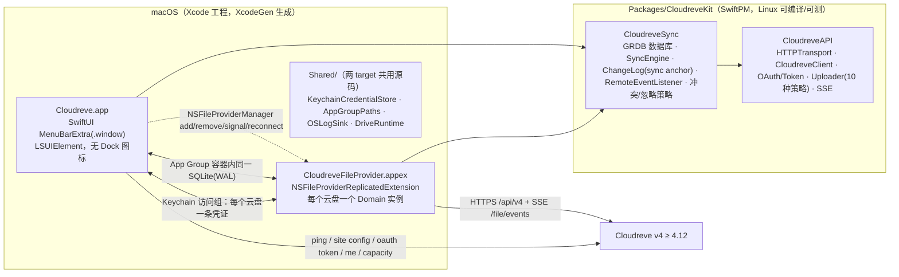

# Cloudreve macOS 客户端

Cloudreve v4（≥ 4.12）的 macOS 原生客户端：

- **Finder 集成**：基于 File Provider（`NSFileProviderReplicatedExtension`），每个云盘以独立域出现在 Finder 侧栏「位置」中，文件按需下载、双向同步，体验与 iCloud Drive / OneDrive 一致。
- **菜单栏弹窗**：点击菜单栏云朵图标查看同步活动（正在同步 / 最近）、按云盘筛选、在 Finder 中定位文件，对标 [cloudreve/desktop](https://github.com/cloudreve/desktop)（Windows 版）。
- **登录**：OAuth2 授权码 + PKCE，复用服务端内置的桌面端 client，与 Windows 版完全一致；凭证存放在 App 与扩展共享的钥匙串访问组中。

最低系统版本 macOS 26，需要 Xcode 27 构建。

## 架构



| 目录 | 内容 |
|---|---|
| `Packages/CloudreveKit/Sources/CloudreveAPI` | 纯协议层：传输抽象、信封解析、Token 刷新（单飞 + 跨进程感知）、URI、分片上传（local/relay/remote/S3 系/OSS/OneDrive/七牛/又拍云）、SSE 解析 |
| `Packages/CloudreveKit/Sources/CloudreveSync` | 同步决策与持久化：GRDB 迁移与各存储、`SyncEngine`（分页枚举差集、变更日志、冲突副本、远端事件应用、全量兜底）、`RemoteEventListener`（SSE 订阅 + 退避重连 + 定期 reconcile） |
| `FileProviderExtension/` | 只做 `NSFileProvider*` 与引擎值类型之间的转换 |
| `App/` | 菜单栏弹窗、添加云盘（OAuth）、设置、通知、域管理 |
| `Shared/` | App 与扩展共用的 App Group 路径、钥匙串凭证、日志与客户端装配 |
| `project.yml` | XcodeGen 工程描述（Info.plist 与 entitlements 由其生成，不入库） |

## 在 Linux 上开发与检查

同步核心（`Packages/CloudreveKit`）可在 Linux 上编译与测试；macOS 专属源码只做语法检查。

```bash
Scripts/install-xcodegen-linux.sh   # 仅首次：从源码构建 XcodeGen
Scripts/check-linux.sh              # swift build + swift test + swiftlint --strict + swiftc -parse + XcodeGen 规范校验
```

## 在 Mac 上构建

前置条件：macOS 26、Xcode 27、Apple Developer Team（File Provider 扩展需要 Team 签名）、`brew install xcodegen swiftlint`。

```bash
cp Config/Local.xcconfig.example Config/Local.xcconfig   # 填入 DEVELOPMENT_TEAM
Scripts/bootstrap-mac.sh                                  # xcodegen generate + xcodebuild Debug
open Cloudreve.xcodeproj
```

Bundle ID：App `plus.ling.cloudreve`，扩展 `plus.ling.cloudreve.fileprovider`，App Group `group.plus.ling.cloudreve`，钥匙串访问组 `$(AppIdentifierPrefix)plus.ling.cloudreve.shared`，URL scheme `cloudreve`。

## 首次运行

1. 启动后菜单栏出现云朵图标（无 Dock 图标），点击弹出窗口。
2. 「添加云盘」→ 输入站点地址 → 校验服务端版本 ≥ 4.12 → 浏览器中登录并授权、在网页弹出的挂载设置里选择远端目录 → 回跳 `cloudreve://mount?...`。
3. 客户端换取 token、写入共享数据库并注册 File Provider 域；Finder 侧栏「位置」出现云盘，`~/Library/CloudStorage/` 下出现对应目录。

## 调试

```bash
fileproviderctl dump                                            # 查看域与条目状态
log stream --predicate 'subsystem == "plus.ling.cloudreve"' --level debug   # 客户端与扩展日志
log stream --info | grep -i fileprovider                        # 系统 File Provider 日志
```

日志级别可在「设置 → 通用」中调整（重启后生效）。

## 同步行为

- 远端变更：订阅挂载根目录的 SSE（`/file/events`），服务端会把整棵子树的事件推送过来；连续失败 5 次后标记「推送中断」，改为每 5 分钟全量 reconcile，正常时每 60 分钟兜底一次。
- 本地变更：由系统调用扩展的 create/modify/delete，上传支持断点续传（会话持久化在共享数据库）。
- 冲突：覆盖上传时以 `previous` 乐观锁检测服务端版本；冲突时本地内容另存为 `__conflict__{yyyyMMddHHmmss}_{原文件名}`，原文件回到服务端版本并发送通知。
- 忽略规则：仅匹配文件名，支持 `*` `?`；内置 `~$*`、`~*.tmp`、`.~lock.*`、`.DS_Store`，可在设置中为每个云盘追加。

## 已知限制

- 不支持要求客户端加密的存储策略（上传会提示「该存储策略要求客户端加密，暂不支持」）。
- 不同步回收站；删除走服务端软删除，可在网页端回收站恢复。
- 不支持大文件部分读取（`NSFileProviderPartialContentFetching`）。
- `MenuBarExtra` 无法区分左右键，Windows 版托盘右键菜单的功能并入弹窗右上角齿轮菜单。

## 许可

MIT
