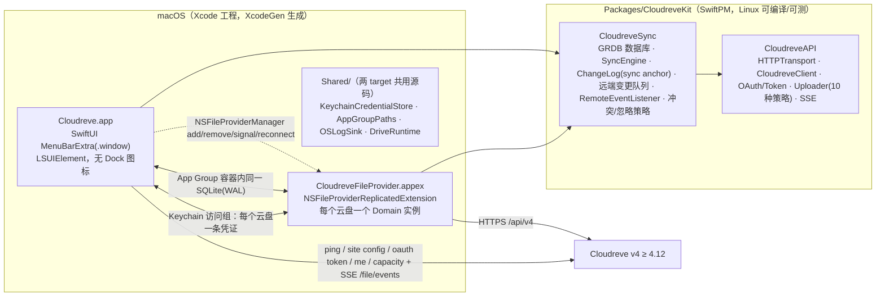

# Cloudreve macOS 客户端

Cloudreve v4（≥ 4.12）的 macOS 原生客户端：

- **Finder 集成**：基于 File Provider（`NSFileProviderReplicatedExtension`），每个云盘以独立域出现在 Finder 侧栏「位置」中，文件按需下载、双向同步，体验与 iCloud Drive / OneDrive 一致。
- **菜单栏弹窗**：点击菜单栏云朵图标查看同步活动（正在同步 / 最近）、按云盘筛选、在 Finder 中定位文件，对标 [cloudreve/desktop](https://github.com/cloudreve/desktop)（Windows 版）。
- **登录**：OAuth2 授权码 + PKCE，复用服务端内置的桌面端 client，与 Windows 版完全一致；凭证存放在 App 与扩展共享的钥匙串访问组中。

最低系统版本 macOS 26，需要 Xcode 27 构建。

## 架构



| 目录 | 内容 |
|---|---|
| `Packages/CloudreveKit/Sources/CloudreveAPI` | 纯协议层：传输抽象、信封解析、Token 刷新（单飞 + 跨进程感知）、URI、分片上传（local/relay/remote/S3 系/OSS/OneDrive/七牛/又拍云）、SSE 解析 |
| `Packages/CloudreveKit/Sources/CloudreveSync` | 同步决策与持久化：GRDB 迁移与各存储、`SyncEngine`（分页枚举差集、变更日志、冲突副本、远端变更队列应用、全量兜底）、`RemoteEventListener`（SSE 订阅 + 退避重连 + 定期 reconcile） |
| `FileProviderExtension/` | 只做 `NSFileProvider*` 与引擎值类型之间的转换 |
| `App/` | 菜单栏弹窗、添加云盘（OAuth）、设置、通知、域管理、远端变更门铃（`RemoteChangeDoorbell`） |
| `Shared/` | App 与扩展共用的 App Group 路径、钥匙串凭证、日志与客户端装配 |
| `project.yml` | XcodeGen 工程描述（Info.plist 与 entitlements 由其生成，不入库） |

## 在 Linux 上开发与检查

同步核心（`Packages/CloudreveKit`）可在 Linux 上编译与测试；macOS 专属源码只做语法检查。

```bash
Scripts/install-xcodegen-linux.sh   # 仅首次：从源码构建 XcodeGen
Scripts/check-linux.sh              # swift build + swift test + swiftlint --strict + swiftc -parse + XcodeGen 规范校验
```

## 在 Mac 上构建

前置条件：macOS 26、Xcode 27、Apple Developer Team（File Provider 扩展需要 Team 签名）、`brew install xcodegen swiftlint`。

```bash
cp Config/Local.xcconfig.example Config/Local.xcconfig   # 填入 DEVELOPMENT_TEAM
Scripts/bootstrap-mac.sh                                  # xcodegen generate + xcodebuild Debug
open Cloudreve.xcodeproj
```

Bundle ID：App `plus.ling.cloudreve`，扩展 `plus.ling.cloudreve.fileprovider`，App Group `$(TeamIdentifierPrefix)plus.ling.cloudreve`（macOS 上 Team 前缀形式无需描述文件授权，个人团队可用），钥匙串访问组 `$(AppIdentifierPrefix)plus.ling.cloudreve.shared`，URL scheme `cloudreve`。

### CI 与发布

- `.github/workflows/ci.yml`：推送到 `main` 和 PR 时在 GitHub `xcode-27` runner（Apple Silicon）上运行 SwiftLint、CloudreveKit 单元测试和 arm64 无签名构建。
- `.github/workflows/release.yml`：推送 `vX.Y.Z` tag 时先跑完整 CI，再编译 arm64 Release 配置并发布 GitHub Release；tag 必须与 `Config/Base.xcconfig` 的 `MARKETING_VERSION` 一致，说明取自 `CHANGELOG.md` 对应版本一节。
- 项目没有 Developer ID 签名，Release 只含说明和 GitHub 自动生成的源码归档；未签名的 arm64 构建只作为该次运行的 Actions artifact 保留，供核对编译结果，不能直接使用。使用者需按上面的步骤用自己的团队构建。不构建 x86_64。

## 首次运行

1. 启动后菜单栏出现云朵图标（无 Dock 图标），点击弹出窗口。
2. 「添加云盘」→ 输入站点地址 → 校验服务端版本 ≥ 4.12 → 浏览器中登录并授权、在网页弹出的挂载设置里选择远端目录 → 回跳 `cloudreve://mount?...`。
3. 客户端换取 token、写入共享数据库并注册 File Provider 域；Finder 侧栏「位置」出现云盘，`~/Library/CloudStorage/` 下出现对应目录。
4. 新注册的域默认未启用：在「系统设置 → 通用 → 登录项与扩展」的「文件提供程序」中打开 Cloudreve（添加完成页与弹窗会提示并提供「打开系统设置」按钮），启用前 Finder 访问云盘会失败。
5. 「设置 → 云盘」：只有一个云盘时显示概览页（大号容量条，以及分享数与浏览量、回收站项目数与保留期、上次完整核对、用户组、存储策略、服务端版本），数据 1 分钟内复用，可手动刷新；多个云盘时每个云盘一张卡片。
   - 概览只调用 O(1) 或小分页接口，不统计各目录大小：服务端的 `folder_summary` 会递归遍历整棵子树（用户组默认每次最多遍历 10 万项，结果只缓存 5 分钟），代价随文件数线性增长。

## 调试

```bash
fileproviderctl dump                                            # 查看域与条目状态
log stream --predicate 'subsystem == "plus.ling.cloudreve"' --level debug   # 客户端与扩展日志
log stream --info | grep -i fileprovider                        # 系统 File Provider 日志
```

日志级别可在「设置 → 通用」中调整（重启后生效）。

## 同步行为

- 远端变更：常驻的 App 为每个云盘订阅挂载根目录的 SSE（`/file/events`，服务端会推送整棵子树），收到即写入共享数据库的 `remote_event` 队列并通知系统刷新 working set；扩展在系统的变更枚举请求内应用队列、成功后才删除，失败时保留并把错误交给系统重试。网页端改动一般在服务端去抖后约 5 秒出现在 Finder。
  - 扩展不自己订阅：它空闲几秒就会被系统回收，而服务端在投递前就删除离线事件，扩展消费到一半被回收会永久丢事件。
  - 订阅成功（含 `resumed`）时做一次全量 reconcile；连续失败 5 次后标记「推送中断」，改为每 5 分钟全量 reconcile，正常时每 60 分钟兜底一次。
  - 因此远端变更需要 App 在运行（默认登录时启动）；App 退出期间的改动在下次启动订阅成功后由 reconcile 补齐。
- 本地变更：由系统调用扩展的 create/modify/delete。删除、重命名、移动先按 id 查到条目在服务端的当前路径再操作，不使用本地镜像里可能过期的路径。
- 上传：分片先流式写入临时文件再从磁盘发送，内存占用与文件大小无关；断点续传会话持久化在共享数据库，只有在覆盖方式与乐观锁版本一致、且已传分片的 SHA-256 与当前文件对应范围一致时才复用，否则重新上传。
- 下载校验：写入字节数必须等于期望大小（当前版本取本地镜像记录，历史版本取服务端记录的实体大小）。服务端是 [OpenCloudreve](https://github.com/Lynricsy/OpenCloudreve)（4.19.10 起）且已为该版本算出 SHA-256 时，还会边下载边计算并比对，不符则丢弃临时文件并报错。
  - 期望摘要在每次下载时按文件 id 查询 `/file/info?extended=true` 获取：与取下载地址并发，拿到后才开始下载正文（传输层不限缓冲，先开始会让正文堆在内存里）。因此每次下载多一个请求；官方 Cloudreve、S3 等非本机/从机存储策略、服务端尚未算完时没有摘要，只校验大小。查询暂时失败（网络错误、408/429/5xx）时，当前版本退回只校验大小；历史版本的期望大小只能来自这次查询，因此本次下载报错，由系统稍后重试，不会交付未校验的内容。
  - 摘要不符多半是服务端存储已损坏，重下无济于事：此时向系统报告「服务器不可达」，系统退避到下次收到通知（远端事件或定期核对）再重试，而不是立即反复下载整个文件。长度不符仍按暂时性错误立即重试（可能只是连接被中途截断）。
  - 客户端不请求服务端计算哈希（`/file/hash` 的 `compute`），只使用已有结果。
- 冲突：
  - 覆盖上传以 `previous` 乐观锁检测服务端版本，锁只取系统提供的版本（本地镜像可能已被远端事件刷新到用户没见过的版本，不能代替）；系统没有提供版本而服务端已有内容时按冲突处理，不会无锁覆盖。内容变更缺少本地文件时直接报错，不会把服务端文件覆盖为空。冲突时本地内容另存为 `__conflict__{yyyyMMddHHmmss}_{原文件名}`，原文件回到服务端版本并发送通知。
  - 删除时若服务端内容已比本地看到的新，拒绝删除，系统按服务端最新版本恢复该文件。
  - 同一目录下名称仅大小写或 Unicode 规范化形式不同视为同名，交给系统改名避让；发往服务端的名称统一为 NFC。
  - 重新导入已存在的同名文件时，只有内容相同才视为同一文件，否则按同名冲突处理：服务端公布了 SHA-256 时只比对摘要，否则下载服务端内容逐字节比较。
- 忽略规则：仅匹配文件名，支持 `*` `?`；内置 `~$*`、`~*.tmp`、`.~lock.*`、`.DS_Store`，可在设置中为每个云盘追加。

## 已知限制

- 不支持要求客户端加密的存储策略（上传会提示「该存储策略要求客户端加密，暂不支持」）。
- 不同步回收站；删除走服务端软删除，可在网页端回收站恢复。
- 不支持大文件部分读取（`NSFileProviderPartialContentFetching`）。
- `MenuBarExtra` 无法区分左右键，Windows 版托盘右键菜单的功能并入弹窗右上角齿轮菜单。
- 上游 Cloudreve 撤销 OAuth 授权后再重新授权，新令牌约一小时后无法刷新（服务端缺陷，[OpenCloudreve#1](https://github.com/Lynricsy/OpenCloudreve/issues/1)，OpenCloudreve 4.19.7 已修复）。

## 许可

MIT
